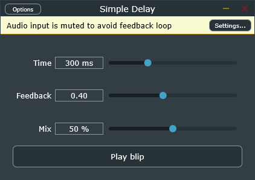

# Simple Delay

A small delay (echo) audio plugin written in C++17 with JUCE 8.0.4. It builds as VST3 and Standalone. I built it from scratch as a learning project, one layer at a time.

## Features

- Three parameters: Time (1 to 1000 ms), Feedback (0 to 0.95) and Mix (0 to 100 %).
- A built-in test sound (a short 880 Hz blip) with a "Play blip" button, so the Standalone can be tested without a DAW or a microphone.
- Circular buffer delay line, one per channel.
- Feedback is capped below 1.0 so the echoes always decay.

## How it works

- `PluginProcessor` runs on the audio thread. It reads the parameters once per block and, for every sample, reads the echo from the delay line, writes `dry + wet * feedback` back, and outputs `dry * (1 - mix) + wet * mix`.
- `PluginEditor` runs on the message (UI) thread. The sliders write the parameters.
- Parameters are `std::atomic<float>`, so the two threads can share them without a data race.
- `DelayLine` is a circular buffer: a fixed-size array and a write index that wraps around. Reading goes backwards from the write index.
- `TestSound` generates the blip with a sine wave and a linear decay envelope.

## Build (Windows)

Requirements: Visual Studio with the C++ tools, CMake 3.22 or newer, and an internet connection (JUCE is downloaded with FetchContent).

    cmake -B build
    cmake --build build --config Debug

The Standalone is created at `build/SimpleDelay_artefacts/Debug/Standalone/Simple Delay.exe`. The VST3 is created in `build/SimpleDelay_artefacts/Debug/VST3/`.

## Known limitations

- Parameters are plain atomics, not an `AudioProcessorValueTreeState`: a DAW cannot see or automate them, and the plugin state is not saved with the project.
- Changing Time while sound is playing produces a click, because the read position jumps. A fix would be to smooth the change or to interpolate between samples.
- The delay is a whole number of samples (no fractional delay).
- The maximum delay is 1 second.
- No limiter: a loud input with high feedback can clip.
- The tail length reported to the host is a fixed 10 seconds.
- Not tested in a DAW with automated tests; it was tested by ear in the Standalone.